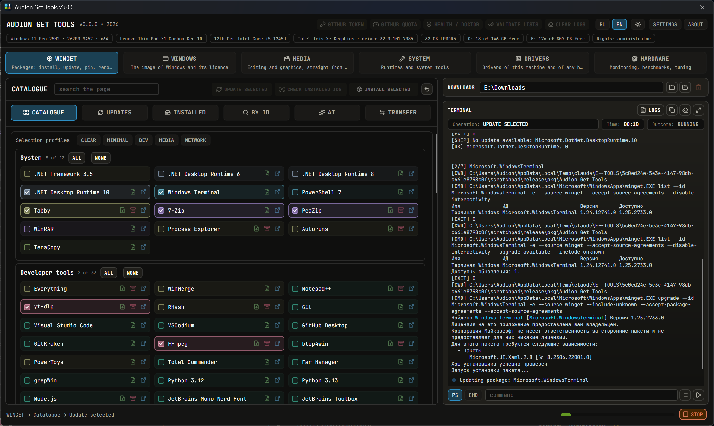

# Audion Get Tools

<!-- audion:release -->
<p align="center">
  <a href="https://audion.dev/downloads/get-tools"></a>
  <a href="https://github.com/Tensionix/get-tools/releases/latest"></a>
  <a href="https://github.com/Tensionix/get-tools/releases"></a>
  <a href="https://github.com/Tensionix/get-tools/blob/main/LICENSE"></a>
</p>

**Version 3.1.0** · 2026-10-12 · 138.0 MB

- [Direct download](https://audion.dev/get/get-tools/3.1.0/Audion_Get_Tools_v3.1.0_Full.zip) — unmetered, no rate limits
- [Project page](https://audion.dev/downloads/get-tools) — every version and how to install

<p align="center"></p>

`SHA-256: 4da30b8ce9e639c26a1e36e339d89bba55d7f17a1e3af11ab723f3068839f102`

---

An **Audion** tool, published by [Tensionix](https://github.com/Tensionix).
<!-- /audion:release -->


[English README](docs/README_EN.md) · [User Guide](docs/USER_GUIDE_EN.md) | [Русский README](docs/README_RU.md) · [Руководство](docs/USER_GUIDE_RU.md)

**Contents**

- [Why It Exists](#why-it-exists)
- [What It Does](#what-it-does)
  - [WinGet sets: the catalog by groups](#winget-sets-the-catalog-by-groups)
  - [Install, update, pin, remove](#install-update-pin-remove)
  - [Download without installing: installer or portable, fresh from the authors](#download-without-installing-installer-or-portable-fresh-from-the-authors)
  - [Search and work by ID](#search-and-work-by-id)
  - [AI Package Planner](#ai-package-planner)
  - [Vendor Downloads](#vendor-downloads)
  - [Visual C++ runtimes](#visual-c-runtimes)
  - [Import and export](#import-and-export)
  - [Service procedures](#service-procedures)
  - [The window](#the-window)
- [Principles](#principles)
- [Next](#next)
- [Technical Reference](#technical-reference)
  - [Running](#running)
  - [Sets](#sets)
  - [How the downloads section is built](#how-the-downloads-section-is-built)
    - [Windows install sets](#windows-install-sets)
    - [Windows app groups](#windows-app-groups)

Install, update, check, export and import sets of programs through the Windows
package manager. Next to it: installers straight from the vendors, Windows
images with the updates already inside, and package planning with an LLM.

## Why It Exists

A new machine means half a day of installing programs one by one. Reinstalling
the system means the same again, and half the programs are remembered only later,
when they turn out to be needed.

Windows can install packages by itself, from a command. But the list of what to
install still has to be kept in your head.

This program keeps it for you: package sets live as lists, and a machine is
brought up with one command. And whatever WinGet lacks, or hands out in the
wrong version, it takes from the vendor directly.

## What It Does

One window: six sections at the top - WINGET, WINDOWS, MEDIA, SYSTEM, DRIVERS,
HARDWARE - and the pages of a section under them. On the left the page: forms
of switches and cards and the buttons that run; on the right the terminal with
the log of the operation. Every button runs an operation that the console
command `get_cli.cmd` runs just the same. Every caption and tooltip exists in
English and Russian, the language switches in the header. One paragraph per
ability below, the details are behind the links into the user guide.

### WinGet sets: the catalog by groups

The catalog is 154 packages in twelve blocks: System, Developer tools, AI, PKMS
and notes, Office and documents, Media (images, audio, video), Browsers, VPN and
communication, Hardware and utilities, MSVC runtimes and the legacy MSVC
2005–2013. A block is a grid of cards with checkboxes; the list has a filter by
name and ID, `Select block` and `Clear block` buttons, and the profile row on
top (Minimal, Dev, Media, Network) ticks a typical set in one press, after which
any card can be changed. The ticks can be saved to YAML and loaded on another
machine.

Since 3.1.0 the catalog has sixteen new cards: Process Monitor, QuickLook and
Ditto in System; .NET SDK 10 in Developer tools; ComfyUI Desktop, LM Studio and
Upscayl in AI; PDF24 Creator, NAPS2, Pandoc and QGIS LTR in Office and
documents; darktable, ExifTool and Blender in images; WinSCP and LocalSend in
the network block. None of them is paid; LM Studio and PDF24 Creator are free
with closed source. No profile includes them: each is ticked on its own.

Every block is a plain list of IDs in the configuration. Your own program is
added as a line, or with `Add ID to list` straight from the search window.

### Install, update, pin, remove

`Install selected` installs everything ticked in the catalogue without the Y/N
prompts, with live progress in the log; what is already installed is passed by.
`Update selected`, `Update available` and `Update all available` work from the
`winget upgrade` list; `Preview updates` only shows it as "name, ID, current,
available". `Pin selected` keeps `config\pins.txt`: ticked packages get a
blocking pin and stop updating until you unpin them. `Remove selected IDs` shows
what is installed by the same blocks; system and runtime IDs are protected by an
extra checkbox. `Update WinGet` updates the manager itself.

### Download without installing: installer or portable, fresh from the authors

Every card carries three small buttons, and that is half the point of the
program. The green arrow downloads the installer into `Downloads` of the
download folder without running it. The crimson box downloads the zip or
standalone build into `Portable`, the one that needs no installation; 39 programs of the
catalog have it, Notepad++, Everything, OBS Studio, VLC, Telegram, FFmpeg,
Node.js, MKVToolNix, Audacity, Sysinternals, Rufus, yt-dlp, SumatraPDF, Rclone,
Pandoc, QuickLook, Ditto, LocalSend, NAPS2, Upscayl
among them, and it shows only where such a build really exists. The blue arrow
opens the download page in the browser: the GitHub releases, the TechPowerUp
page or the vendor's site, to pick a build yourself — another architecture, an
older version.

The files come straight from the authors, not from someone's mirror: for
projects on GitHub the program reads the latest release and picks the right
file among the assets itself, x64 and portable first; for the rest, the vendor's
page. So the newest version lands in the download folder even when the WinGet catalog lags:
Tabby and RClone Manager are taken from the releases page before they reach the
catalog, and the installer and the portable build are always the same version.
More: [user guide](docs/USER_GUIDE_EN.md#downloading-without-installing).

### Search and work by ID

For programs outside the catalog: `winget search` by name from the program's
window, install and remove by a typed ID, add a found ID into one of the catalog
blocks so that next time it is a card.

### AI Package Planner

Describe the task in words, "a video editor's workstation with Resolve and
FFmpeg", and an LLM (OpenAI or Gemini) proposes packages. Every candidate is
checked through `winget search`, only exact IDs make it into the plan, and only
those you tick get installed. Keys and models live on the `Models` tab,
instruction templates are pinned and reused. Installation goes the usual
protected way; the LLM runs nothing. More:
[user guide](docs/USER_GUIDE_EN.md#ai-package-planner).

### Vendor Downloads

In the window the drivers stand by the kind of device - GPU, Chipset, Wi-Fi,
Bluetooth, Ethernet, Audio - and every page has a row of makers: Intel and AMD
first, then Realtek and the rest. Where the file comes from follows from the
maker, and a page opens on the maker this PC has a device of. Over the list of
versions stands a badge: the driver the PC runs now and the newest of the list.

A second source next to WinGet: the vendors' own catalogs with every version
they ever published, not just the current one. Tabs at the top, platforms and
products below, then version cards with dates; each can be downloaded or just
linked. Downloads resume after a break, zips are unpacked, a lone root folder
in the archive is dropped.

- **Windows through UUP dump**: any Windows 11 or 10 build from Microsoft's
  catalog with the cumulative update inside, the ISO built on the spot. Image
  kind Business, Consumer or Pro only; a Store app set (Minimal, Work,
  Everything) and the ballast group buttons; the Edge browser is the first
  card of the list, off in Minimal and Work, on in Everything, while the Edge
  WebView2 runtime is untouched and stays for apps; this machine's
  drivers embed into the image by their ticks, packages under `input` join the same list. The build runs in `UUP` at the root of the program's drive, the image
  lands in the destination folder.
- **TechPowerUp**: the site's catalog with the whole version history of every
  entry, by section. Drivers: AMD Radeon and Ryzen chipset, Intel graphics,
  Wi-Fi, Bluetooth, Ethernet and NPU, Qualcomm Snapdragon X. Utilities: DDU,
  NVCleanstall, NVIDIA Profile Inspector, ThrottleStop, DRAM Calculator, Samsung
  Magician, Visual C++ Runtimes AIO, MemTest64. Monitoring: GPU-Z, CPU-Z,
  AIDA64, ZenTimings, Real Temp. Benchmarks: 3DMark, PCMark 10, Cinebench,
  FurMark, Prime95, Unigine, GravityMark, Linpack Xtreme, ATTO. Video BIOS:
  NVFlash, AMDVBFlash. The file comes from TechPowerUp's own signed link. A
  version is one card with two arrows, like the WinGet cards: the green one
  fetches the installer, the crimson archive icon fetches the portable build of
  the same version, which runs without installation; the Portable button turns
  the whole list to portable files. Some of these utilities are in the WinGet
  catalog too: there they install into the system, here any version comes as a
  file.
- **Windows Update**: the drivers Windows Update installs, taken by hand from
  the Microsoft Update Catalog - bare WHQL INF drivers without the vendor's
  programs. Realtek, MediaTek, Qualcomm, Broadcom, Killer and Marvell network,
  Wi-Fi, Bluetooth and sound, Intel Management Engine and RST. The list is
  searched by the hardware id of this PC's own device, the newest driver for
  it is ticked; a package is checked for Microsoft's signature, then unpacked.
- **Intel Chipset**: Intel Chipset Device Software (the chipset INF), every
  package from 10.0.13 on. The Intel devices of this PC choose the package.
  The sources in turn: Intel's server, the web archive, station-drivers, the
  FirstEverTech archive; every installer is checked for the signature of Intel
  Corporation. Intel's own addresses are kept in
  `config\vendor_intel_chipset.yaml`.
- **NVIDIA**: Game Ready and Studio drivers by chip generation, `My cards` for
  one driver across every card in the house; each version carries its NVENC
  SDK, the compatible FFmpeg, the CUDA ceiling and ★ "golden" marks. Game
  Ready has a `Source` switch: NVIDIA's own service (the default - the list by
  generation and `My cards`) or TechPowerUp (every release in one list at
  once, the file compared by SHA256 and checked for NVIDIA's signature).
  Plus the NVIDIA App, Broadcast, CUDA Toolkit and the three DLSS libraries.
- **Blackmagic Design**: DaVinci Resolve and Resolve Studio, Fusion, Blackmagic
  RAW, Desktop Video, Camera Setup and the rest of the catalog, 45 products.
  Studio comes without registration; the free Resolve only through the form,
  which is in the window.
- **Affinity**: the unified Affinity 3 (exe, msix, dmg) and Photo, Designer,
  Publisher 2.
- **Programs as files**: the newest installer or portable build from its
  maker, nothing installed - what the WinGet catalogue of the program does not
  carry. Boot media: Media Creation Tool, Rufus, Ventoy. Utilities: ViVeTool,
  SoundSwitch, EverythingPowerToys, ExplorerTabUtility, Symbolic11, Nilesoft
  Shell, KDE Connect, Bulk Crap Uninstaller, Revo Uninstaller, VeraCrypt,
  Microsoft Safety Scanner, RustDesk, Google Chrome, Edge WebView2 Runtime,
  Intel Driver and Support Assistant. Tests: PresentMon, CapFrameX, PC Latency
  View, TestMem5, Fan Control. Games: Steam, Epic, EA app, Battle.net, Rockstar,
  Riot, Minecraft, Prism, Freesm, Modrinth, CurseForge, TcNo Account Switcher.
  The list is `config\programs.yaml`; a program in it may carry a line of what
  it is - it is shown as the tooltip of its card.
- **Craft**: a page in MEDIA for the [Craft App Suite](https://getartcraft.com/apps) -
  the free apps of the [ArtCraft](https://getartcraft.com) project
  ([sources on GitHub](https://github.com/storytold)), stand-ins for the paid
  suites. Everything is taken as a file; the page itself installs nothing. The
  place to start is [ArtCraft Launcher](https://github.com/storytold/craft-launcher):
  its portable build runs without an installation, keeps its settings beside
  itself, in `ArtCraftLauncherData`, and installs and updates the apps of the
  suite itself. Every app is taken as a file too: PhotoCraft, LightCraft,
  VectorCraft, DesignCraft, FilmCraft, EffectCraft, SoundCraft, PdfCraft,
  WordCraft, GridCraft, DeckCraft, CADCraft - as a portable build or an
  installer, and the studio ArtCraft for images and video by neural networks -
  as an installer. These are early versions with a release almost every day. A
  downloaded file is checked against the checksum file of its release; another
  sum, or no sum for it - the file is renamed `.untrusted` and the operation
  fails. There is one exception, and its card says so: the installer of the
  studio ArtCraft has neither a digital signature nor a checksum file in its
  release, so there is nothing to check it against. A portable build is unpacked into `Portable` over the former one: the
  folder is not emptied. A Craft app, unlike the launcher, keeps its settings
  in `%APPDATA%`, not in its own folder. Audion Get Tools is not part of the
  ArtCraft project: it takes its releases from GitHub as they are.

More: [user guide](docs/USER_GUIDE_EN.md#vendor-downloads), the composition tables
below in the [technical reference](#windows-install-sets).

### Visual C++ runtimes

The MSVC 2015+ block in the catalog, the legacy 2005–2013 as a separate block,
and two All-in-One bundles (TechPowerUp and abbodi1406) that install every
runtime in one pass, including 2012, which WinGet does not have at all.
`Check MSVC runtimes` shows what is installed and what is available. The
project's classic CMD scripts are available as buttons. More:
[user guide](docs/USER_GUIDE_EN.md#visual-c-runtime-bundles-msvc).

### Import and export

`winget export` to JSON from a configured machine and `winget import` on a new
one, with the checkboxes "ignore versions", "do not upgrade installed" and
"ignore unavailable".

### Service procedures

Buttons without a form stand where they are needed. In the header: the GitHub
token, the GitHub quota, Health / Doctor, the validation of the configuration
lists and the clearing of the logs. The Windows licence state through slmgr is
in WINDOWS, page "Licence"; the MSVC runtime check in SYSTEM, "Runtimes"; the
check that IDs exist in WINGET, "Catalogue"; the clearing of the program's
`input` and `output` beside the row of the download folder. The GitHub token is
asked for in a pop-up field, the token is checked against GitHub and
kept in `config\github_token.dpapi` encrypted with Windows DPAPI for this
account only; with it the release lookups get 5000 API calls an hour instead
of the anonymous 60. The `GitHub quota` button shows what is left.

### The window

The header shows the machine in badges: Windows, the computer, the processor,
the video cards with their drivers, the memory, the free room of the drives and
the rights of the window. An image of Windows needs administrator rights:
`Start.exe` asks for them at the start, and in a window opened without them a
click on "Rights: standard" restarts it with the rights. The language RU / EN,
the four Audion themes and the sheets "Settings" and "About" are there too.

Over the terminal stands the download folder: the Downloads of Windows until
another is chosen; the program's `output` or a folder of your own is picked
right there or in the settings. The pages that read a folder - the WinGet
import, the drivers for an image - show the source folder and let it be
chosen. The catalogue and the list of what is installed have one search for
all the lists of the page. The terminal shows the log of the operation in the
colours of the services themselves; beside it are the buttons of the `logs`
folder, of copying and of clearing, the tiles "operation, time, outcome" and
`STOP`. Under the terminal stands its command line: PowerShell or cmd, Enter
runs, the arrows bring the commands before; the list beside it holds the pinned
commands and the history, and a command may be pinned or removed there. A
command sent while an operation goes runs after it. Dangerous operations ask for confirmation before they run. Where every
operation stands and what every control means is in the
[guide's reference](docs/USER_GUIDE_EN.md#reference-every-window-every-control-every-tooltip).

## Principles

**A set is a list of names.** An ordinary text file where a package is added as a
line. No proprietary format, no database of its own.

**Export and import.** The list is taken from a configured machine and applied to
a new one.

**Checking is separate from installing.** First you see what will be installed and
what is missing from the source — then it installs.

**Nothing happens silently.** Installing, removing and anything that changes the
system asks for confirmation; downloads and checks run at once.

**Two languages everywhere.** Every caption, tooltip and message has an English
and a Russian version.

## Next

* [User Guide](docs/USER_GUIDE_EN.md) — step by step, plus the reference of every control.

---

## Technical Reference

### Running

```cmd
Start.exe                    the window
get_cli.cmd                  the console command: the operations the buttons of the window run
launcher_project.cmd         the console menu of WinGet by lists
launcher_project_ru.cmd      the same in Russian
```

The window is `App\AudionGetTools.exe`, built from `Source\` with its own .NET;
the engine is Python in `runtime\`. The window installs and downloads nothing
itself: every button runs an operation of the manifest through `get_cli.cmd`.
Beside the window stands `App\AudionPs.exe` - the program's own PowerShell 7:
the command line of the terminal and the console menus of WinGet run with it,
so the program needs no PowerShell installed on the machine. Examples:

```cmd
get_cli.cmd describe
get_cli.cmd run --operation preview_available_updates
get_cli.cmd run --operation install_package_by_id --set package_id=7zip.7zip
```

### Sets

Package lists live in the configuration as separate files — one per machine
purpose. Operations, fields and tooltips are described in
`config\tool_manifest.yaml`, and the page of the section an operation stands
on in `config\window_layout.yaml`; the control reference in the user guide is
built from them by `system_core\build_control_reference.py`.

### How the downloads section is built

A provider describes one catalog
(`system_core\vendors\`: Blackmagic Design, Affinity, NVIDIA, Windows through UUP dump, the Microsoft
Update Catalog, the Intel chipset and the programs taken as files from `config\programs.yaml`; the NVIDIA
driver marks sit in `config\vendor_nvidia.yaml`), the shared
`vendor_service` fetches the chosen builds with resume into a folder per build
and unpacks zips, and the form of the downloads is one field group in
`tool_manifest.yaml`, its fields shown by `visible_when`; a page of the window
shows it for its own vendor (`fixed` in `window_layout.yaml`).
A new vendor is one provider file, its platform and product toggles in the
manifest, a line in `vendor_service.VENDOR_FIELDS` and a page in the layout.

#### Windows install sets

Install sets, the buttons of the `App set` row; each one just fills the card list, which can then be edited by hand or with the group buttons:

| Set | Packages | What gets installed | Who it is for |
|---|---|---|---|
| `Minimal` | 4 | system only: Store, Store purchases, Windows Security, App Installer | an image for an application server or a kiosk that needs nothing from the Store while WinGet and Store updates keep working |
| `Work` | 26 | the system packages, thirteen tools (Notepad, Windows Terminal, Calculator, Snipping Tool, Paint, Camera, Sound Recorder, Phone Link, Clock, Sticky Notes, To Do, Weather, Power Automate) and nine codecs | a work machine without entertainment and promotion; the default, and the reference image was built with it |
| `Everything` | 59 | the whole catalog with Edge, as Microsoft ships it, only with the list open for editing | when everything stock is wanted with the option to untick a card or two |

The `Image kind` row above is about editions, not apps: `Business` is Pro plus Enterprise, Education, Pro Education and Pro for Workstations, `Consumer` is Home and Pro plus Education, Pro Education and Pro for Workstations, `Pro only` is one edition. Sets and image kinds combine freely.

#### Windows app groups

The whole Store package catalog the way the program divides it: the `Work` set plus the seven buttons of the `Include in the distribution build` row. 59 cards in total, Edge among them, nothing sits outside a group.

| Group | Count | Inside | By default |
|---|---|---|---|
| System | 4 | Microsoft Store, Store purchases, Windows Security, App Installer (WinGet) | in the image, `Work` set |
| Tools | 13 | Notepad, Windows Terminal, Calculator, Snipping Tool, Paint, Camera, Sound Recorder, Phone Link, Clock, Sticky Notes, To Do, Weather, Power Automate | in the image, `Work` set |
| Codecs | 9 | Web Media, RAW images, HEIF, HEVC, VP9, WebP, AV1, MPEG-2, AVC encoder | in the image, `Work` set |
| Media stack | 4 | Media Player, Films & TV, Photos, Clipchamp | off |
| Edge | 1 | the Edge browser only; the Edge WebView2 runtime is untouched and stays, apps run and are built on it | off |
| Xbox | 6 | Xbox app, Xbox Game Bar, Xbox Game overlay, Xbox speech overlay, Xbox identity, Xbox TCUI | off |
| Teams and mail | 6 | Teams, Outlook (new), Mail and Calendar, People, Office hub (M365), Family | off |
| Bing and widgets | 6 | Bing Search, News, Widgets (web experience), Widgets runtime, Start experiences, Cortana | off |
| Promo and helpers | 8 | Solitaire, Tips, Get Help, Feedback Hub, Quick Assist, Dev Home, PC Manager, App compatibility enhancements | off |
| Small tools | 2 | Maps, Cross Device | off |

The `Minimal` set is the four system packages without the tools and the codecs, `Everything` turns every group on at once. OneDrive and Copilot are not in the catalog: they are not Store packages and are removed after installation.
